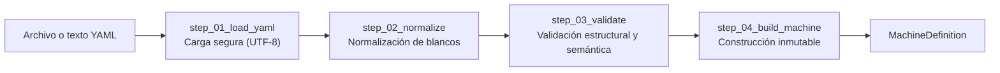

# Guía de Arquitectura, Dominio y Configuración YAML

Este documento está pensado para cualquier integrante que se incorpore al proyecto. Explica cómo está organizado el código base, cómo funciona el pipeline de carga y validación de archivos YAML, y cómo consumir el modelo `MachineDefinition` para construir el motor de simulación o una interfaz gráfica sin necesidad de acoplarse al formato YAML.

---

## 1. Panorama General

El paquete `tm_simulator` transforma un archivo o cadena YAML en un objeto de dominio completamente validado e inmutable llamado `MachineDefinition`.



### Principios de diseño
1. **Separación estricta de capas**:
   - `tm_simulator.domain`: Contiene los modelos de datos inmutables y las excepciones públicas. **No depende de PyYAML** ni de detalles de entrada/salida.
   - `tm_simulator.configuration`: Contiene el pipeline de 4 pasos que lee el YAML, normaliza el símbolo blanco, valida todas las reglas formales y construye `MachineDefinition`.
   - `tm_simulator.__main__`: CLI ligero de diagnóstico para validar archivos YAML desde la terminal.
2. **Inmutabilidad real**:
   - Una vez construida una `MachineDefinition`, ninguna de sus colecciones (`states`, `input_alphabet`, `tape_alphabet`, `transitions`, `simulation_strings`) puede ser alterada.
3. **Recolección acumulativa de errores**:
   - Si un archivo YAML tiene varios problemas estructurales o semánticos, el validador no se detiene en el primero: recopila todos los hallazgos posibles en `MachineValidationError.issues` indicando código, ruta exacta (`path`) y mensaje en español.

---

## 2. Cómo usar la API Pública (Para el Motor de Simulación)

Si vas a implementar la cinta, las descripciones instantáneas (IDs) o el motor de ejecución de transiciones, **no importes los módulos internos `step_*`**. Utiliza únicamente las fachadas públicas de `tm_simulator.configuration` y `tm_simulator.domain`:

```python
from tm_simulator.configuration import load_machine_from_file, load_machine_from_text
from tm_simulator.domain import (
    ConfigurationError,
    MachineDefinition,
    MachineValidationError,
    Movement,
    TransitionEffect,
    TransitionKey,
    ValidationIssue,
    YamlLoadError,
    YamlSyntaxError,
)
```

### Ejemplo: Consultar una transición durante la simulación

```python
from tm_simulator.configuration import load_machine_from_file
from tm_simulator.domain import Movement, TransitionKey

machine = load_machine_from_file("tests/fixtures/yaml/recognizer_w_hash_w.yaml")

# Estado inicial y estado de aceptación
current_state = machine.initial_state
current_memory: str | None = None
current_tape_symbol: str | None = "a"  # None representa el blanco (blank)

# Construir la llave de búsqueda para delta([q, mem], simbolo_cinta)
key = TransitionKey(
    state=current_state,
    memory_value=current_memory,
    read_symbol=current_tape_symbol,
)

effect = machine.transitions.get(key)
if effect is None:
    # No existe transición definida -> la máquina se detiene (rechaza si current_state != machine.final_state)
    print("Sin transición disponible")
else:
    print(f"Siguiente estado: {effect.next_state}")
    print(f"Nueva memoria caché: {effect.next_memory_value}")
    print(f"Escribir en cinta: {effect.write_symbol}")
    if effect.movement is Movement.RIGHT:
        print("Mover cabezal a la derecha")
    elif effect.movement is Movement.LEFT:
        print("Mover cabezal a la izquierda")
    elif effect.movement is Movement.STAY:
        print("Mantener cabezal en la misma celda")
```

---

## 3. Modelos de Dominio (`src/tm_simulator/domain/models.py`)

| Clase | Tipo | Campos principales | Notas |
| :--- | :--- | :--- | :--- |
| `Movement` | `StrEnum` | `LEFT = "L"`, `RIGHT = "R"`, `STAY = "S"` | Dirección de movimiento del cabezal en cada paso. |
| `TransitionKey` | `dataclass(frozen=True)` | `state: str`<br>`memory_value: str \| None`<br>`read_symbol: str \| None` | Hashable e inmutable. Representa la entrada de $\delta([q, m], a)$. `None` representa el símbolo blanco. |
| `TransitionEffect` | `dataclass(frozen=True)` | `next_state: str`<br>`next_memory_value: str \| None`<br>`write_symbol: str \| None`<br>`movement: Movement` | Representa la salida de la transición $([q', m'], b, D)$. `None` representa el símbolo blanco. |
| `MachineDefinition` | `dataclass(frozen=True)` | `states: frozenset[str]`<br>`initial_state: str`<br>`final_state: str`<br>`input_alphabet: frozenset[str]`<br>`tape_alphabet: frozenset[str \| None]`<br>`transitions: Mapping[TransitionKey, TransitionEffect]`<br>`simulation_strings: tuple[str, ...]` | Realiza copias defensivas en su inicializador y expone `transitions` mediante `MappingProxyType`. |

---

## 4. Manejo de Errores (`src/tm_simulator/domain/errors.py`)

Todas las excepciones heredan de `ConfigurationError`:

- **`YamlLoadError`**: Fallo al abrir o leer el archivo físico (archivo inexistente, ruta que apunta a un directorio, permisos insuficientes o codificación UTF-8 inválida). Expone `err.path` y `err.reason`.
- **`YamlSyntaxError`**: El archivo existe pero su sintaxis YAML está malformada (o intenta usar etiquetas inseguras). Expone `err.problem`, `err.line` y `err.column`.
- **`MachineValidationError`**: El YAML se cargó pero incumple una o más reglas estructurales o semánticas. Expone `err.issues: tuple[ValidationIssue, ...]`, donde cada `ValidationIssue` contiene:
  - `code`: Identificador estable del error (ej. `"unknown_state"`, `"duplicate_transition"`, `"missing_blank_in_tape_alphabet"`).
  - `path`: Ruta exacta dentro del YAML (ej. `"delta[2].output.final_state"`, `"tape_alphabet"`, `"simulation_strings[0]"`).
  - `message`: Explicación legible en español lista para mostrarse en CLI o frontend.

---

## 5. Recorrido Interno del Pipeline (`src/tm_simulator/configuration/`)

1. **`step_01_load_yaml.py`**:
   - Lee archivos explícitamente con `encoding="utf-8"`.
   - Usa exclusivamente `yaml.safe_load`.
   - Verifica que el documento no esté vacío y que la raíz sea un mapeo (`dict`).
2. **`step_02_normalize.py`**:
   - Normaliza las representaciones válidas del símbolo blanco a `None` **únicamente** en `tape_alphabet` y en los campos de símbolo/memoria de `delta` (`mem_cache_value`, `tape_input`, `tape_output`).
   - Reconoce como blanco: entrada vacía en YAML, `null`, `~` y el texto `"None"` (sin distinguir mayúsculas/minúsculas).
   - No convierte silenciosamente enteros ni booleanos a cadenas, ni muta el diccionario recibido.
3. **`step_03_validate.py`**:
   - Verifica la estructura completa del documento (`q_states`, `alphabet`, `tape_alphabet`, `delta`, `simulation_strings`) y los tipos de cada campo.
   - Comprueba todas las invariantes semánticas de la Máquina de Turing:
     - Estados no vacíos, sin duplicados, y estados `initial`/`final` declarados en `q_list`.
     - `alphabet` con símbolos de 1 carácter, sin duplicados y sin símbolo blanco.
     - `tape_alphabet` con todos los símbolos de `alphabet`, sin duplicados y con **exactamente una** representación del blanco (`None`).
     - Transiciones en `delta` con estados válidos, símbolos de cinta/memoria pertenecientes a `tape_alphabet`, desplazamientos en `{"L", "R", "S"}` y sin llaves `TransitionKey` duplicadas.
     - Cadenas en `simulation_strings` formadas exclusivamente por caracteres de `alphabet` (admitiendo la cadena vacía `""`).
4. **`step_04_build_machine.py`**:
   - Transforma el diccionario validado en una instancia inmutable de `MachineDefinition`.
5. **`pipeline.py`**:
   - Conecta los 4 pasos anteriores detrás de `load_machine_from_file` y `load_machine_from_text`.

---

## 6. Particularidades del Formato YAML

### Símbolo blanco (`blank`)
En YAML se recomienda expresar el blanco dejando el valor vacío, o bien usando `null`, `~` o `None`:

```yaml
tape_alphabet:
  - a
  - b
  - X
  -
```

> [!WARNING]
> `tape_alphabet` debe incluir **exactamente una** representación del blanco. Si se colocan dos entradas vacías o se mezcla `null` y `None` dentro de `tape_alphabet`, el validador lo rechazará como símbolo duplicado (`duplicate_symbol`).

### Uso del carácter `#` como símbolo
En YAML, cualquier `#` sin comillas precedido de espacio o al inicio de valor abre un comentario y `yaml.safe_load` lo descarta antes de procesar los datos. Si tu máquina utiliza `#` como símbolo (por ejemplo en el lenguaje $\{w\#w\}$), escríbelo **siempre entre comillas** en las listas de alfabetos y transiciones:

```yaml
alphabet:
  - a
  - b
  - "#"
```

