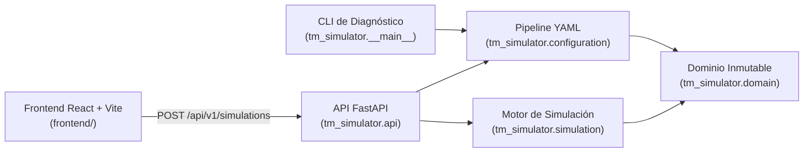

# Guía de Arquitectura, Simulación, API y Frontend

Este documento describe la arquitectura completa del proyecto `tm_simulator` para cualquier integrante o evaluador que necesite comprender cómo se conectan la configuración YAML, el dominio, el motor de simulación, la API HTTP y la interfaz web.

---

## 1. Arquitectura General por Capas

### Principios de diseño
1. **Dominio aislado (`tm_simulator.domain`)**: Modelos inmutables y excepciones públicas sin dependencias de PyYAML, FastAPI ni UI.
2. **Pipeline de configuración (`tm_simulator.configuration`)**: Convierte YAML en una `MachineDefinition` validada e inmutable sin exponer la estructura interna del YAML al resto del sistema.
3. **Motor determinista sin acoplamiento HTTP (`tm_simulator.simulation`)**: Ejecuta máquinas validas sobre una cinta infinita manteniendo registro completo de descripciones instantáneas (IDs).
4. **Contrato HTTP sin estado (`tm_simulator.api`)**: Expone endpoints REST en FastAPI para validar, simular lotes o consultar pasos concretos.
5. **Frontend interactivo (`frontend/`)**: Consume la API vía proxy `/api` para editar YAML, ejecutar simulaciones y reproducir paso a paso la cinta y sus IDs.

---

## 2. Modelos de Dominio y Errores (`src/tm_simulator/domain/`)

### Modelos (`models.py`)

| Clase | Tipo | Campos principales | Notas |
| :--- | :--- | :--- | :--- |
| `Movement` | `StrEnum` | `LEFT = "L"`, `RIGHT = "R"`, `STAY = "S"` | Dirección de movimiento del cabezal en cada paso. |
| `TransitionKey` | `dataclass(frozen=True)` | `state: str` `memory_value: str \| None` `read_symbol: str \| None` | Hashable e inmutable. Representa la entrada de $\delta([q, m], a)$. `None` representa el símbolo blanco. |
| `TransitionEffect` | `dataclass(frozen=True)` | `next_state: str` `next_memory_value: str \| None` `write_symbol: str \| None` `movement: Movement` | Representa la salida $([q', m'], b, D)$. `None` representa el símbolo blanco. |
| `MachineDefinition` | `dataclass(frozen=True)` | `states: frozenset[str]` `initial_state: str` `final_state: str` `input_alphabet: frozenset[str]` `tape_alphabet: frozenset[str \| None]` `transitions: Mapping[TransitionKey, TransitionEffect]` `simulation_strings: tuple[str, ...]` | Realiza copias defensivas y expone `transitions` mediante `MappingProxyType`. |

### Excepciones (`errors.py`)
Todas heredan de `ConfigurationError`:
- **`YamlLoadError`**: Archivo inexistente, directorio, permisos insuficientes o codificación UTF-8 inválida (`path`, `reason`).
- **`YamlSyntaxError`**: Sintaxis YAML malformada o etiquetas inseguras (`problem`, `line`, `column`).
- **`MachineValidationError`**: Agrupa en `issues: tuple[ValidationIssue, ...]` todos los errores estructurales y semánticos detectados (`code`, `path`, `message`).

---

## 3. Pipeline de Configuración YAML (`src/tm_simulator/configuration/`)

La fachada pública expone únicamente `load_machine_from_file` y `load_machine_from_text` (`pipeline.py`), coordinando 4 etapas internas:

1. **`step_01_load_yaml.py`**: Lectura explícita en UTF-8 y análisis seguro con `yaml.safe_load`; rechaza documentos vacíos o raíces que no sean mapeos.
2. **`step_02_normalize.py`**: Normaliza a `None` las representaciones del blanco (vacío, `null`, `~`, `"None"` sin distinguir mayúsculas/minúsculas) únicamente en `tape_alphabet` y en los campos de símbolo/memoria de `delta` (`mem_cache_value`, `tape_input`, `tape_output`), sin mutar ni convertir otros tipos silenciosamente.
3. **`step_03_validate.py`**: Valida estructura, tipos e invariantes semánticas (estados declarados, `alphabet` $\subset$ `tape_alphabet`, exactamente un blanco en `tape_alphabet`, desplazamientos `L`/`R`/`S`, ausencia de `TransitionKey` duplicadas y cadenas de `simulation_strings` válidas). Recopila todos los hallazgos en `MachineValidationError`.
4. **`step_04_build_machine.py`**: Construye la `MachineDefinition` inmutable.

### Particularidades del formato YAML
- **Símbolo blanco**: Se recomienda entrada vacía (`-` en lista o campo vacío), `null`, `~` o `None`. `tape_alphabet` debe incluir exactamente uno.
- **Carácter `#`**: En YAML un `#` sin comillas inicia un comentario y `yaml.safe_load` lo descarta. Siempre que se use como símbolo de entrada o cinta debe escribirse entre comillas (`"#"`).

---

## 4. Motor de Simulación (`src/tm_simulator/simulation.py`)

Ejecuta una `MachineDefinition` sobre una cinta infinita indexada por enteros (`dict[int, str]`, donde las posiciones ausentes representan el blanco `None`):

- **`Simulator(machine, input_string, *, max_steps=10_000)`**:
  - Valida que todos los caracteres de `input_string` pertenezcan a `machine.input_alphabet` y que `max_steps >= 1`.
  - Inicia en `head = 0`, `state = machine.initial_state`, `memory = None`, `steps = 0`, guardando la ID inicial en `snapshots`.
  - `step()`: Aplica una transición buscando `TransitionKey(state, memory, cells.get(head))`. Actualiza cinta, estado, memoria, cabezal (`L` = `-1`, `R` = `+1`, `S` = `0`) y registra el nuevo `Snapshot` y `AppliedTransition`.
  - Se detiene por una de cuatro razones (`HaltReason`):
    - `ACCEPTED` (`"accepted"`): El estado actual alcanza `machine.final_state`.
    - `NO_TRANSITION` (`"no_transition"`): No existe transición definida para la configuración actual (la cadena es rechazada).
    - `STEP_LIMIT` (`"step_limit"`): Se alcanzó `max_steps` sin aceptar ni quedar sin transición (estado `"indeterminate"`).
    - `LOOP` (`"loop"`): La configuración completa (estado, memoria caché, posición del cabezal y contenido de la cinta) ya había ocurrido antes. Como la máquina es determinista, repetiría esa misma secuencia para siempre, así que se detiene de inmediato con estado `"rejected"` sin esperar a `max_steps`. La ID repetida queda como último snapshot. Solo detecta ciclos exactos: una máquina que avanza indefinidamente con la cinta creciendo nunca repite una configuración y termina en `STEP_LIMIT`.
- **`simulate(machine, input_string, *, max_steps=10_000) -> SimulationResult`**: Ejecuta hasta detenerse y retorna `SimulationResult` con `status`, `halt_reason`, `steps`, `final_tape`, `snapshots` y `transitions`.

---

## 5. Contrato HTTP (`src/tm_simulator/api.py`)

Aplicación FastAPI (`app`) sin estado en el servidor:

- **`POST /api/v1/simulations`**:
  - Cuerpo (`SimulationRequest`): `yaml: str`, `input: str | None = None`, `max_steps: int = 10_000` (`1..10_000`).
  - Si `input` es `None`, ejecuta todas las `simulation_strings` definidas en el YAML.
  - Respuesta (`SimulationBatchResponse`): Lista de `SimulationResultSchema` con toda la traza de `snapshots` y `transitions`.
- **`POST /api/v1/simulations/step`**:
  - Cuerpo (`StepRequest`): Igual a `SimulationRequest` más `step: int` (`0..10_000`), con `input` obligatorio.
  - Respuesta (`StepResponse`): Devuelve el `snapshot`, `halt_reason` y `transition` del paso solicitado (`404` si la máquina se detuvo antes de alcanzar `step`).
- **Errores HTTP `422`**:
  - `invalid_machine` (incluye la lista `issues` de `MachineValidationError`), `invalid_yaml`, `invalid_input` o `input_required`.

---

## 6. Frontend Web (`frontend/`)

Aplicación en React 19 + TypeScript + Vite (`frontend/src/`):

- **`api/client.ts` y `api/types.ts`**: Cliente HTTP tipado contra `/api/v1/simulations` (en desarrollo, Vite redirige `/api` a `http://127.0.0.1:8000` según `frontend/vite.config.ts`).
- **`examples.ts`**: Carga como presets los fixtures YAML de `tests/fixtures/yaml/` (`recognizer_w_hash_w.yaml`, `alterer_complement_ab.yaml`, `alterer_reverse_ab.yaml`).
- **`components/YamlEditor.tsx`**: Selector de ejemplos, editor de texto YAML, entrada opcional de cadena (vacía = simular todas las `simulation_strings` del YAML) y límite de pasos.
- **`components/ErrorPanel.tsx`**: Muestra los errores de sintaxis, validación (`path` + `message`) o entrada devueltos por el backend.
- **`components/ResultTabs.tsx`, `Tape.tsx`, `Controls.tsx`, `IdTable.tsx`, `ResultBadge.tsx` y `usePlayer.ts`**: Pestañas por cada cadena simulada, visualización animada de la cinta con la posición del cabezal, memoria caché, reproducción paso a paso (play/pausa, anterior/siguiente, inicio/fin, velocidad) y tabla completa de descripciones instantáneas (IDs).
