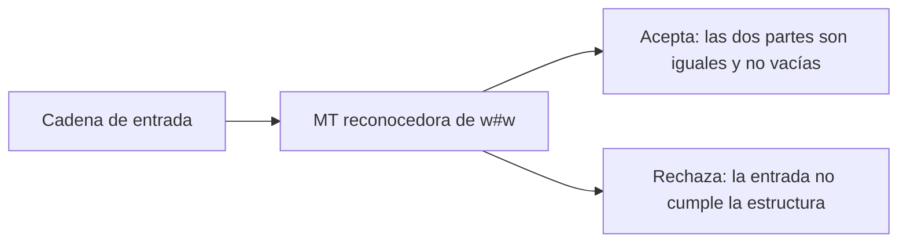
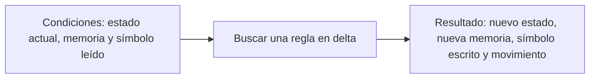
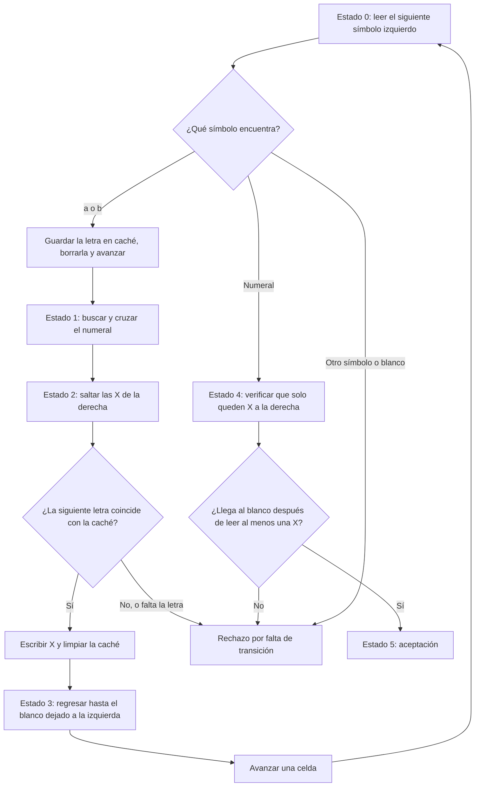
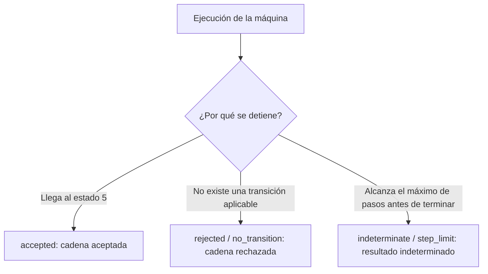

# Material visual para el video: Máquina de Turing reconocedora

## 1. Propósito de la MT reconocedora

El símbolo `+` en `{a, b}+` indica una o más letras. El numeral `#` es el separador y aparece una sola vez en las cadenas del lenguaje.

## 2. Explicación de la arquitectura de la MT en el YAML

**En pantalla:** seleccionar **Reconocedora: w#w** y mostrar el editor YAML, sin ejecutar todavía los ejemplos.

| Campo | Qué representa en esta máquina |
| --- | --- |
| `q_states` | Estados `0`, `1`, `2`, `3`, `4` y `5`. El inicial es `0` y el de aceptación es `5`. |
| `alphabet` | Símbolos permitidos en la entrada: `a`, `b` y `#`. |
| `tape_alphabet` | Símbolos que pueden aparecer en la cinta: `a`, `b`, `#`, `X` y blanco. |
| `delta` | Reglas para cambiar de estado, actualizar la memoria, escribir y mover el cabezal. |
| `simulation_strings` | Cadenas que se ejecutan al solicitar los ejemplos del YAML. |

En esta explicación, `□` representa una celda en blanco. En el YAML se puede representar dejando vacío el campo correspondiente. El símbolo `#` se escribe entre comillas para que YAML no lo interprete como un comentario.

### 2.1. Qué significa una transición

### 2.2. Cómo compara las dos partes

El diagrama resume el procedimiento. También se rechaza si falta el numeral, aparece otro separador o se encuentra un símbolo sin transición durante el recorrido.

### 2.3. Para qué sirve cada estado

| Estado | Función |
| --- | --- |
| `0` | Toma la siguiente `a` o `b` izquierda, la guarda en caché y la borra. Si lee `#`, pasa a la revisión final. |
| `1` | Avanza sobre las letras restantes de la izquierda hasta cruzar `#`, conservando la letra en caché. |
| `2` | Salta las `X` y compara la siguiente letra derecha con la caché. Si coincide, escribe `X`, limpia la memoria y vuelve a la izquierda. |
| `3` | Retrocede hasta encontrar el blanco dejado al borrar una letra izquierda. Luego avanza una celda y vuelve al estado `0`. |
| `4` | Recorre las `X` de la derecha. Al leer una `X`, guarda `X` en memoria para registrar que hubo al menos una comparación. |
| `5` | Estado de aceptación. Se alcanza desde `4` al leer blanco con `X` en memoria. |

```mermaid
stateDiagram-v2
    [*] --> q0
    q0 --> q1: Toma y borra una letra; la guarda en caché
    q1 --> q1: Avanza sobre a o b
    q1 --> q2: Cruza el numeral
    q2 --> q2: Salta X
    q2 --> q3: Coincide; escribe X y limpia caché
    q3 --> q3: Retrocede sobre a, b, numeral o X
    q3 --> q0: Encuentra blanco y avanza
    q0 --> q4: Lee numeral
    q4 --> q4: Lee X y guarda X en memoria
    q4 --> q5: Lee blanco con X en memoria
    q5 --> [*]
```

Los nombres `q0` a `q5` del diagrama corresponden a los estados `0` a `5` del YAML. Las flechas resumen grupos de transiciones y sus movimientos. Cualquier combinación sin regla detiene la ejecución con rechazo, salvo que ya se haya alcanzado el estado `5`.

## 3. Demostración de cadenas de prueba en el frontend

**En pantalla:** mantener seleccionada **Reconocedora: w#w**, ingresar `ab#ab` y ejecutar. Señalar los elementos de la interfaz antes de recorrer los pasos.

### 3.1. Qué muestra el simulador

| Elemento | Qué explicar |
| --- | --- |
| Cinta | Muestra los símbolos que quedan y las marcas `X`. |
| Cabezal | La flecha señala la celda que se está leyendo. |
| Estado | Indica qué parte del procedimiento está ejecutando la máquina. |
| Memoria | Guarda temporalmente una letra durante la comparación, o `X` durante la verificación final. |
| Controles | Permiten avanzar, retroceder, reproducir, pausar o ir al inicio y al final. |
| Tabla de descripciones instantáneas | Registra cada paso, la configuración de la cinta, la memoria y la transición aplicada. |

### 3.2. Cómo interpretar el resultado

### 3.3. Ejemplos de la reconocedora

Ahora pasar al simulador y realizar las demostraciones. Todos los resultados de esta sección se comprobaron con la configuración `recognizer_w_hash_w.yaml` del proyecto y un límite de 10 000 pasos.

#### Demostración paso a paso: `ab#ab`

Ingresar `ab#ab`, ejecutar y volver al primer paso. Avanzar manualmente para mostrar una comparación completa. Después continuar con la segunda y la revisión final.

En estos momentos de la ejecución, la cinta queda así:

| Paso | Celdas 0 a 5 | Estado | Memoria | Posición del cabezal |
| --- | --- | --- | --- | --- |
| 0 | `a b # a b □` | `0` | `□` | 0 |
| 1 | `□ b # a b □` | `1` | `a` | 1 |
| 4 | `□ b # X b □` | `3` | `□` | 2 |
| 7 | `□ b # X b □` | `0` | `□` | 1 |
| 8 | `□ □ # X b □` | `1` | `b` | 2 |
| 11 | `□ □ # X X □` | `3` | `□` | 3 |
| 14 | `□ □ # X X □` | `0` | `□` | 2 |
| 15 | `□ □ # X X □` | `4` | `□` | 3 |
| 17 | `□ □ # X X □` | `4` | `X` | 5 |
| 18 | `□ □ # X X □` | `5` | `□` | 5 |

La tabla muestra momentos seleccionados, no todas las transiciones. Se mantienen las posiciones 0 a 5 para comparar los cambios, aunque la vista del simulador ajuste las celdas visibles.

#### Casos incluidos en el YAML

Dejar vacío el campo de entrada y ejecutar para correr las cuatro cadenas de `simulation_strings`. Después seleccionar cada pestaña de resultados.

| Cadena | Resultado | Pasos | Explicación |
| --- | --- | --- | --- |
| `aab#aab` | Aceptada | 32 | Ambas partes son iguales y no vacías. |
| `abbba#abbba` | Aceptada | 72 | Coinciden todas las letras y no sobra ninguna. |
| `aab#aba` | Rechazada | 13 | En la segunda comparación se espera `a`, pero se encuentra `b`. |
| `abbababa#aba` | Rechazada | 47 | La tercera comparación falla: se espera `b`, pero se encuentra `a`. Además, las longitudes son distintas. |

#### Casos adicionales de la reconocedora

Si queda tiempo, ingresar estas cadenas individualmente para mostrar otras condiciones.

| Cadena | Resultado | Pasos | Qué demuestra |
| --- | --- | --- | --- |
| `a#a` | Aceptada | 8 | Cada mitad puede tener una sola letra. |
| `#` | Rechazada | 1 | Las mitades no pueden estar vacías. |
| `ab#aba` | Rechazada | 17 | Se rechaza cuando sobran letras a la derecha. |
| `ab#` | Rechazada | 3 | Se rechaza cuando falta la letra correspondiente a la derecha. |
| `ab` | Rechazada | 2 | Se rechaza una entrada sin separador. |
